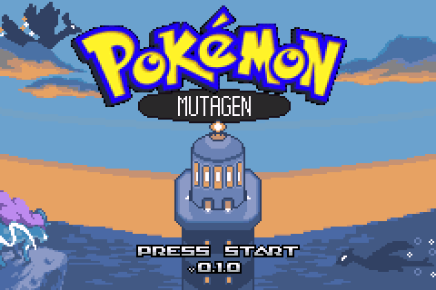

# Pokémon Mutagen

A Game Boy Advance Pokémon game: a fork of [Pokémon Heart & Soul](docs/hns/README.md) 2.0.6, the
GSC remake / HGSS demake. You get all of Heart & Soul's Johto and Kanto, its options and challenges,
plus fixes and new options of our own. Everything new is an option, and switched off the game plays
like Heart & Soul. Bigger systems (a third type, signature moves, new items) are planned, each behind
its own option ([backlog](docs/pokerom/BACKLOG.md)).

Current version: **0.1.0** ([what changed](docs/pokerom/CHANGELOG.md)). It is made for real GBA
hardware (a flash cart) and for RetroArch's mGBA core on a phone; each release's notes say how it
did on both.

## Play

1. Get a Pokémon Emerald (USA) ROM with SHA-1 `f3ae088181bf583e55daf962a92bb46f4f1d07b7`. We don't
   provide ROMs or links to them.
2. Apply `pokemon-mutagen-0.1.0.bps` from the release page to a copy of it, with
   [Flips](https://github.com/Alcaro/Flips) on a computer or UniPatcher on Android. RetroArch can
   also patch on the fly: put the `.bps` next to the ROM with the same file name.
3. Play it in mGBA, in RetroArch with the mGBA core, or on a flash cart.

- The save type is FLASH 1M (128 KB); emulators and most flash carts pick it on their own.
- The game uses the cartridge clock. On a cart or emulator without one, choose FAKE RTC in the
  options you get when you start a new game.
- Saves from Heart & Soul 2.0.6 carry over: load the same save file with the patched ROM.

## Bugs

Please report bugs in this repository's issues, not to the Heart & Soul team, since a bug here may be
ours. Say which version you play (it's on the title screen) and where it happened.

## Credits

Pokémon Mutagen is built on Pokémon Heart & Soul 2.0.6 by the PokemonHnS-Development team, itself
built on resetes12's Modern Emerald, Rom Hacking Hideout's pokeemerald-expansion 1.15.1 and pret's
pokeemerald decompilation. Heart & Soul's contributors are listed in [CREDITS.md](CREDITS.md) and its
[README](docs/hns/README.md). Fixes and features ported from Pokémon Heart & Soul+ (Marcogn) and
Pokémon Soulgold (Eemeliri) are recorded, with the commits they came from, in
[PROVENANCE.md](docs/pokerom/PROVENANCE.md).

Pokémon is © Nintendo, Creatures Inc. and GAME FREAK inc. This is a free fan project, not affiliated
with them; it ships only a patch, never a ROM.

## AI disclosure

Most of the code changes in this fork were written with an AI coding assistant (Claude Code), from
the maintainer's direction, and tested with the automated checks below. The title banner's M, G and
N and the version's 1 were drawn by that assistant in Heart & Soul's existing pixel font, at the
maintainer's request; everything else in the art, and all music and story text, is Heart & Soul's
or credited in PROVENANCE.md. Heart & Soul's own disclosure is in [its README](docs/hns/README.md).

## Build it yourself

`make hns` builds the development ROM and `tools/release.sh` the release and its patch; setup,
toolchain notes and the checks (battle-test gate, headless playtests, map and trainer sweeps) are in
[CLAUDE.md](CLAUDE.md) §1 and [INSTALL.md](INSTALL.md). Releases follow
[docs/pokerom/RELEASE.md](docs/pokerom/RELEASE.md).
