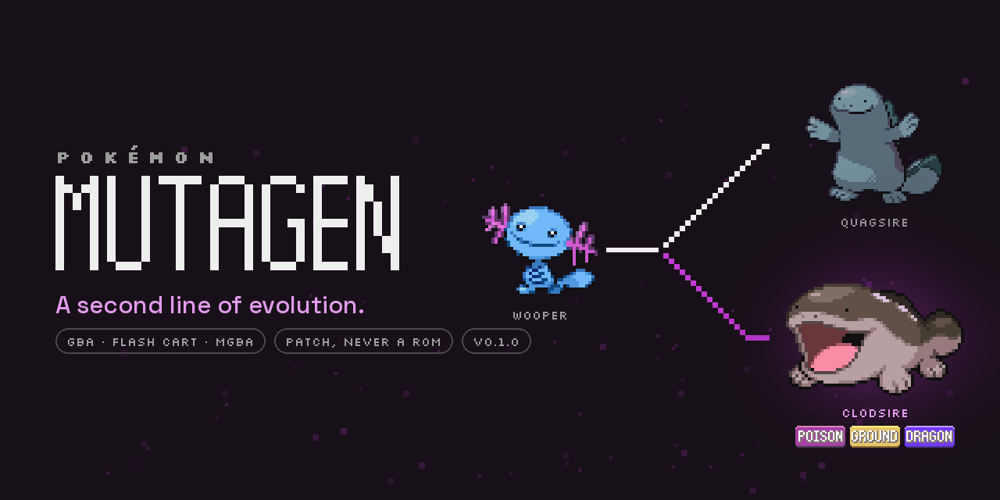
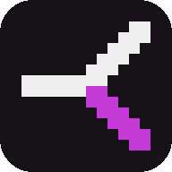

# Brand

How Pokémon Mutagen looks wherever a person meets it: the README, this site, the social preview,
the videos' title cards and the voxel view's HUD. Every asset is written by `tools/brand/brand.py`
from the game's own pixels and two open-licence fonts. Nothing in it is a generated image.

## The idea

The Mutagen is a mutant strain of Pokérus that gives a Pokémon a second line of evolution. The
brand says that with one shape: a line that forks, the usual arm in the text colour, the lower arm
in the strain's magenta. Everything else is the title screen's own material: its banner font for
the word, its greys for the grounds, the game's sprites for the Pokémon.

## Colours

The first five are pixels of the title banner (`graphics/title_screen/hns/emerald_version.gbapal`),
so the brand and the game agree. The strain and the graft are the brand's own two accents.

| Name | Hex | Role |
|---|---|---|
| ink | `#181018` | the banner's outline: the dark ground; text on paper |
| pill | `#292929` | the banner's fill: panels and cards on ink |
| seam | `#4A4A4A` | the banner's mid grey: borders and rules on ink |
| ash | `#9C9C9C` | the banner's light grey: muted text and labels on ink |
| bone | `#EEEEEE` | the banner's letters: text on ink |
| strain | `#C43AD6` | the Mutagen: its line, the highlight, the lower arm of the mark |
| strain-deep | `#8A1E9C` | the strain as text on paper (links, labels) |
| strain-soft | `#E39BEE` | the strain as text on ink (taglines, links) |
| graft | `#A6F23A` | the graft: the third type, success; the rare second accent on ink |
| graft-deep | `#3F7A0A` | the graft as text on paper |
| paper | `#F7F4F8` | the light ground |
| paper-2 | `#ECE6EE` | panels and cards on paper |

Rules. Ink is the ground of every brand surface (covers, cards, title cards, the HUD); reading pages
are paper in the light theme and ink in the dark one. The strain marks the Mutagen's line and is the
one accent on a surface; the graft appears only where the third type or a success is meant, never
beside the strain on the same element. Text takes the "-deep" or "-soft" tone of its accent; the
plain strain is for shapes and large type. No gradients, except the soft glow behind a Mutagen twin.

Measured contrast (WCAG 2), from `tools/brand/brand.py contrast`:

| Text | On | Ratio | Use |
|---|---|---|---|
| bone `#EEEEEE` | ink `#181018` | 16.1:1 | any text |
| ash `#9C9C9C` | ink `#181018` | 6.8:1 | body text |
| strain `#C43AD6` | ink `#181018` | 4.4:1 | large text, UI |
| strain-soft `#E39BEE` | ink `#181018` | 9.0:1 | any text |
| graft `#A6F23A` | ink `#181018` | 13.7:1 | any text |
| ink `#181018` | paper `#F7F4F8` | 17.1:1 | any text |
| strain-deep `#8A1E9C` | paper `#F7F4F8` | 7.0:1 | any text |
| strain `#C43AD6` | paper `#F7F4F8` | 3.9:1 | large text, UI |
| graft-deep `#3F7A0A` | paper `#F7F4F8` | 4.8:1 | body text |
| bone `#EEEEEE` | pill `#292929` | 12.5:1 | any text |
| strain-soft `#E39BEE` | pill `#292929` | 7.1:1 | any text |
| ink `#181018` | strain `#C43AD6` | 4.4:1 | large text, UI |
| bone `#EEEEEE` | strain `#C43AD6` | 3.7:1 | large text, UI |

## Type

- **The wordmark** is the title screen's MUTAGEN: Heart & Soul's pixel small caps, 11 pixels tall,
  one-pixel strokes, traced from the banner sheet. Scale it by whole numbers (×1 in the game, ×8 to
  ×16 on covers) or use the SVGs, which stay crisp at any size. It is never anti-aliased, stretched
  or set in the strain colour: bone on ink, ink on paper. The banner font has no P, K or É, so
  "Pokémon" is never set in it.
- **Eyebrows and labels**: [Silkscreen](https://fonts.google.com/specimen/Silkscreen) (OFL 1.1),
  upper case, letter-spaced 0.2 em, at multiples of 8 px: the POKÉMON eyebrow, the chips, the
  captions under sprites, the sidebar's part titles, the version.
- **Text and headings**: [Space Grotesk](https://fonts.google.com/specimen/Space+Grotesk) (OFL
  1.1); 400 for text, 500 for taglines, 700 for headings. Code stays in mdbook's Source Code Pro.
- Proportions follow the wordmark's pixel ("unit"): the eyebrow is 2 units tall, the tagline about
  2.9 units, the gap between eyebrow and word 1.6 units, between word and tagline 2.2 units.

## The mark

The fork, on a 12 × 12 grid with two-square strokes: a stem of seven squares, then two stair arms,
each five steps, to the top and bottom right corners. The stem and the upper arm are bone (ink on
paper); the lower arm is always the strain. The favicon is the mark at 12 of 16 units on an ink
square with corners of 3/16. Smallest size 16 px. Never rotate it, never recolour the lower arm.

 

The wide fork (`fork.svg`, 40 × 24) joins a Pokémon to its two lines on the landing page, as the
cover's fork does: stem, then stairs to the corners.

## The wordmark's clear space and the pill

Keep two units clear around the word. The title screen's banner shape, the pill (fill `pill`,
outline `seam`, radius half its height, padding 3 units at the sides and 2 above and below), may
carry the mark and the word together; that is how the game shows the name, so it is the lockup of
last resort when a surface needs a container.

## Layouts

- **Cover**, 1280 × 640 (`cover.png`; the README header, the GitHub social preview and the site's
  `og:image`): ink with the spore texture (seeded dots of the strain, denser to the lower right);
  the block at the left (eyebrow, wordmark ×12, tagline, three chips); the fork tree at the right:
  the base Pokémon ×4, the usual evolution ×3 dimmed (55 % saturation, 70 % opacity), the
  Mutagen's twin ×4 with the glow and its three type icons from the game.
- **Title card**, 1920 × 1080 for the voxel video and 960 × 640 for GBA footage: eyebrow, mark and
  wordmark centred, the subtitle in strain-soft. `tools/brand/brand.py titlecard --subtitle "…"`.
- **Sprites** are the game's front sprites, cropped to their pixels and scaled by whole numbers,
  never smoothed. The usual line is dimmed; the Mutagen's twin glows.
- **Spacing**: an 8 px grid. Corners 10 px on cards, 16 px on the hero, pills fully round.
- **Captions on video**: Space Grotesk Bold with a strain bar at the left for the map or scene
  name; Space Grotesk Medium in ash for the footer line; the title card for 2.5 s first.

## Voice

Plain sentences, the thing named. The tagline is "A second line of evolution." The chips say what
a player needs before anything else: GBA · flash cart · mGBA; patch, never a ROM; the version.

## Files

| File | Use |
|---|---|
| `docs/pokerom/brand/cover.png` | README header, social preview (upload by hand: repository Settings → Social preview), `og:image` |
| `docs/pokerom/brand/wordmark.svg`, `wordmark-ink.svg`, `wordmark-inline.svg` | the word, on ink / on paper / `currentColor` for inlining |
| `docs/pokerom/brand/mark.svg`, `mark-ink.svg`, `mark-inline.svg`, `fork.svg`, `fork-inline.svg` | the mark and the wide fork |
| `docs/pokerom/brand/wordmark-path.js`, `mutagen.js`, `mutagen.css` | the site: the lockup in the menu bar, the theme |
| `docs/pokerom/brand/icon-512.png`, `icon-192.png`, `apple-touch-icon.png`; `docs/theme/favicon.svg`, `favicon.png` | icons |
| `docs/pokerom/brand/fonts/` | Space Grotesk and Silkscreen, Latin subsets, with their OFL texts (`tools/brand/fonts.py`) |

Regenerate everything with `tools/brand/brand.py`; the cover's other two compositions (the lineup
of twins, the pill alone) come out of `tools/brand/brand.py variants --out DIR`. Sources and terms
are rows in [PROVENANCE.md](../PROVENANCE.md).

## Don'ts

- No Nintendo marks in the brand assets: the Pokémon logotype stays on the in-game title screen only.
- No generated images, anywhere. New letters in the banner font need a line in the README's disclosure.
- No second accent on an element, no gradients, no smoothed sprites, no wordmark in the strain colour.
