# Mutagen evolutions

A Pokémon that carries the Mutagen, the mutant strain of Pokérus, and outlives it can evolve along
a second line when it next levels up: the Mutagen's twin of its usual evolution, a form the game's
data already held (the Paradox and regional relatives). The usual line stays open; the Mutagen
line is the highlighted one. The strain's parity decides Donphan's two twins. Generated from the
species data by `tools/site/evolutions.py`: 26 families.

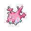Corsola

Level up, Mutagen

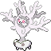Cursola

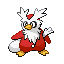Delibird

Level up, Mutagen

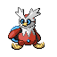Iron Bundle

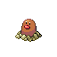Diglett

Lv. 26

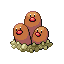Dugtrio

Level up, Mutagen

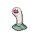Wiglett

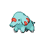Phanpy

Lv. 25

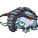Donphan

Level up, Mutagen, even strain

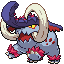Great Tusk

Level up, Mutagen, odd strain

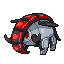Iron Treads

Diglett

Lv. 26

Dugtrio

Level up, Mutagen

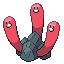Wugtrio

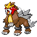Entei

Level up, Mutagen

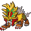Gouging Fire

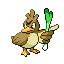Farfetch'd

Level up, Mutagen

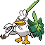Sirfetch'd

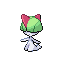Ralts

Lv. 20

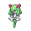Kirlia

Dawn Stone, male

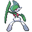Gallade

Level up, Mutagen

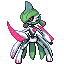Iron Valiant

Ralts

Lv. 20

Kirlia

Lv. 30

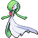Gardevoir

Level up, Mutagen

Iron Valiant

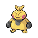Makuhita

Lv. 24

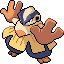Hariyama

Level up, Mutagen

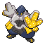Iron Hands

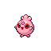Igglybuff

Level up, friendship high

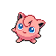Jigglypuff

Moon Stone

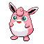Wigglytuff

Level up, Mutagen

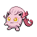Scream Tail

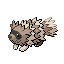Zigzagoon

Lv. 20

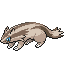Linoone

Level up, Mutagen

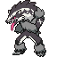Obstagoon

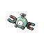Magnemite

Lv. 30

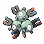Magneton

Level up, at route 10

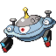Magnezone

Level up, at power plant

Magnezone

Thunder Stone

Magnezone

Level up, Mutagen

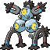Sandy Shocks

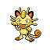Meowth

Lv. 28

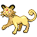Persian

Level up, Mutagen

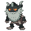Perrserker

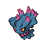Misdreavus

Dusk Stone

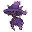Mismagius

Level up, Mutagen

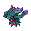Flutter Mane

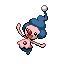Mime Jr.

Level up, knows mimic, not in galar

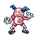Mr. Mime

Level up, Mutagen

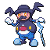Mr. Rime

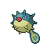Qwilfish

Level up, Mutagen

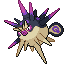Overqwil

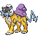Raikou

Level up, Mutagen

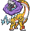Raging Bolt

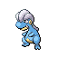Bagon

Lv. 30

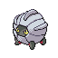Shelgon

Lv. 50

Salamence

Level up, Mutagen

Roaring Moon

Scyther

Trade, holding metal coat

Scizor

Metal Coat

Scizor

Black Augurite

Kleavor

Level up, Mutagen

Kleavor

Sneasel

Level up, night, holding razor claw

Weavile

Razor Claw, night

Weavile

Level up, Mutagen

Sneasler

Suicune

Level up, Mutagen

Walking Wake

Tentacool

Lv. 30

Tentacruel

Level up, Mutagen

Toedscool

Tentacool

Lv. 30

Tentacruel

Level up, Mutagen

Toedscruel

Larvitar

Lv. 30

Pupitar

Lv. 55

Tyranitar

Level up, Mutagen

Iron Thorns

Wooper

Lv. 20

Quagsire

Level up, Mutagen

Clodsire

