# Relics: the species parts

With **MUTAGEN → RELICS** on, a species part used from the bag on a party Pokémon is *worn*: it shows
on the Pokémon's battle sprite, front and back, and in its summary, and the Pokémon has what the part
gives, whatever its species: an ability, or a family of moves that hits harder (slash, stab, bite,
punch, sound, wind, ballistic or blunt; a few parts add a critical-hit stage or venom to those
moves). Using another part asks to swap; the party menu's ITEM → TAKE OFF (or using the same part
again) takes it off, and the part goes back to the bag. Nothing is written to the Pokémon but the
part's index, so taking a part off gives it back exactly as it was. Every part is the donor
species' own pixels, cut by `tools/relics/cut.py` (nothing is drawn); the ROM colours it with the
donor's palette.

Where they come from: a wild Pokémon of the donor species drops its part one time in four when it
faints (RELICS on). **CHEAT SHELF → ALL** sells every part in every Poké Mart, and the sandbox build
starts with one of each. Generated from the same table the ROM is built from: 41 parts.

<table class="relics">
<thead><tr><th></th><th>Part</th><th>Worn, it gives</th><th>Type lent</th><th>Where it sits</th><th>Front and back</th></tr></thead>
<tbody>
<tr><td>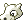</td><td><b>CUBONE SKULL</b> cut from Cubone's own sprites</td><td>Rock Head</td><td>Ground</td><td>on the head</td><td>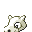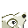</td></tr>
<tr><td>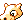</td><td><b>CHARIZARD SKULL</b> the Cubone skull in Charizard's colours</td><td>Solar Power</td><td>Fire</td><td>on the head</td><td>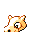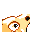</td></tr>
<tr><td>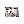</td><td><b>HEAD SHELL</b> cut from Onix's own sprites</td><td>Rock Head</td><td>Rock</td><td>on the head</td><td>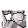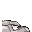</td></tr>
<tr><td>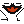</td><td><b>ARBOK VENOM</b> cut from Arbok's own sprites</td><td>Poison Touch</td><td>Poison</td><td>over the face</td><td>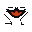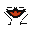</td></tr>
<tr><td>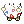</td><td><b>TOGEPI SHELL</b> cut from Togepi's own sprites</td><td>Serene Grace</td><td>Fairy</td><td>around the body</td><td>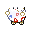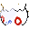</td></tr>
<tr><td>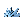</td><td><b>PUPITAR SHELL</b> cut from Pupitar's own sprites</td><td>Shed Skin</td><td>Rock</td><td>on the head</td><td>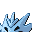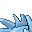</td></tr>
<tr><td>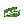</td><td><b>LOTAD LILY</b> cut from Lotad's own sprites</td><td>Rain Dish</td><td>Water</td><td>on the head</td><td>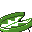</td></tr>
<tr><td>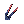</td><td><b>SWELLOW TAIL</b> cut from Swellow's own sprites</td><td>Guts</td><td>Flying</td><td>on the back (behind the Pokémon when it faces you)</td><td>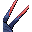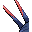</td></tr>
<tr><td>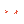</td><td><b>KIRLIA ANTENNA</b> cut from Kirlia's own sprites</td><td>Telepathy</td><td>Psychic</td><td>on the head</td><td>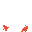</td></tr>
<tr><td>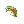</td><td><b>BRELOOM CAP</b> cut from Breloom's own sprites</td><td>Effect Spore</td><td>Grass</td><td>on the head</td><td>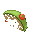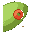</td></tr>
<tr><td>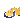</td><td><b>HARIYAMA PANTS</b> cut from Hariyama's own sprites</td><td>Thick Fat</td><td>Fighting</td><td>around the body</td><td>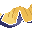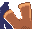</td></tr>
<tr><td>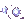</td><td><b>SABLEYE EYES</b> cut from Sableye's own sprites</td><td>Keen Eye</td><td>Dark</td><td>over the face</td><td>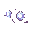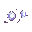</td></tr>
<tr><td>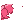</td><td><b>ROSELIA ROSE</b> cut from Roselia's own sprites</td><td>Natural Cure</td><td>Grass</td><td>on the head</td><td>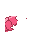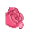</td></tr>
<tr><td></td><td><b>SHARPEDO SKIN</b> cut from Sharpedo's own sprites</td><td>Rough Skin</td><td>Water</td><td>on the head</td><td>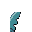</td></tr>
<tr><td>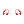</td><td><b>FLYGON EYES</b> cut from Flygon's own sprites</td><td>Compound Eyes</td><td>Ground</td><td>over the face</td><td>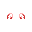</td></tr>
<tr><td>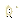</td><td><b>DUSKULL MASK</b> cut from Duskull's own sprites</td><td>Infiltrator</td><td>Ghost</td><td>over the face</td><td>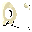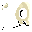</td></tr>
<tr><td>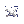</td><td><b>METAGROSS CROSS</b> cut from Metagross's own sprites</td><td>Clear Body</td><td>Steel</td><td>over the face</td><td>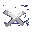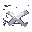</td></tr>
<tr><td>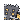</td><td><b>BASTIODON SHIELD</b> cut from Bastiodon's own sprites</td><td>Sturdy</td><td>Rock</td><td>over the face</td><td>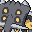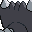</td></tr>
<tr><td>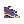</td><td><b>SKUNTANK OIL</b> cut from Skuntank's own sprites</td><td>Stench</td><td>Poison</td><td>on the head</td><td></td></tr>
<tr><td></td><td><b>SCYTHER WINGS</b> cut from Scyther's own sprites</td><td>Technician</td><td>Bug</td><td>on the back (behind the Pokémon when it faces you)</td><td></td></tr>
<tr><td></td><td><b>LAPRAS SHELL</b> cut from Lapras's own sprites</td><td>Shell Armor</td><td>Water</td><td>on the back (behind the Pokémon when it faces you)</td><td></td></tr>
<tr><td></td><td><b>MAREEP WOOL</b> cut from Mareep's own sprites</td><td>Static</td><td>Electric</td><td>around the body</td><td></td></tr>
<tr><td></td><td><b>SNEASEL FEATHER</b> cut from Sneasel's own sprites</td><td>Pickpocket</td><td>Dark</td><td>on the head</td><td></td></tr>
<tr><td></td><td><b>MAGCARGO SHELL</b> cut from Magcargo's own sprites</td><td>Flame Body</td><td>Fire</td><td>on the back (behind the Pokémon when it faces you)</td><td></td></tr>
<tr><td></td><td><b>KABUTOPS CLEAVERS</b> cut from Kabutops's own sprites</td><td>slash moves ×1.2</td><td>Rock</td><td>on the back (behind the Pokémon when it faces you)</td><td></td></tr>
<tr><td></td><td><b>PINSIR HORNS</b> cut from Pinsir's own sprites</td><td>stab moves ×1.2</td><td>Bug</td><td>on the head</td><td></td></tr>
<tr><td></td><td><b>BEEDRILL STINGER</b> cut from Beedrill's own sprites</td><td>stab moves ×1.2; a stab that hits poisons one time in ten</td><td>Bug</td><td>around the body</td><td></td></tr>
<tr><td></td><td><b>PIDGEOT FEATHERS</b> cut from Pidgeot's own sprites</td><td>wind moves ×1.2</td><td>Flying</td><td>on the head</td><td></td></tr>
<tr><td></td><td><b>PREDATOR TEETH</b> cut from Feraligatr's own sprites</td><td>bite moves ×1.2</td><td>Water</td><td>over the face</td><td></td></tr>
<tr><td></td><td><b>SANDSLASH CLAWS</b> cut from Sandslash's own sprites</td><td>slash moves ×1.1 and a critical-hit stage</td><td>Ground</td><td>around the body</td><td></td></tr>
<tr><td></td><td><b>DRILL HORN</b> cut from Rhydon's own sprites</td><td>stab moves ×1.2</td><td>Ground</td><td>over the face</td><td></td></tr>
<tr><td></td><td><b>BAYLEEF LEAF BLADE</b> cut from Bayleef's own sprites</td><td>slash moves ×1.2</td><td>Grass</td><td>on the head</td><td></td></tr>
<tr><td></td><td><b>LOUDRED EARS</b> cut from Loudred's own sprites</td><td>sound moves ×1.2</td><td>Normal</td><td>on the head</td><td></td></tr>
<tr><td></td><td><b>SEVIPER VENOM</b> cut from Seviper's own sprites</td><td>bite moves ×1.1; a bite that hits poisons one time in ten</td><td>Poison</td><td>over the face</td><td></td></tr>
<tr><td></td><td><b>ABSOL BLADE</b> cut from Absol's own sprites</td><td>slash moves ×1.1 and a critical-hit stage</td><td>Dark</td><td>on the head</td><td></td></tr>
<tr><td></td><td><b>EMPOLEON TRIDENT</b> cut from Empoleon's own sprites</td><td>stab moves ×1.2</td><td>Water</td><td>on the head</td><td></td></tr>
<tr><td></td><td><b>MAMOSWINE TUSK</b> cut from Mamoswine's own sprites</td><td>stab moves ×1.2 (poached: no wild drop; the black market's, later)</td><td>Ice</td><td>over the face</td><td></td></tr>
<tr><td></td><td><b>OCTILLERY CANNON</b> cut from Octillery's own sprites</td><td>ballistic moves ×1.2</td><td>Water</td><td>over the face</td><td></td></tr>
<tr><td></td><td><b>HAXORUS BLADE</b> cut from Haxorus's own sprites</td><td>slash moves ×1.2</td><td>Dragon</td><td>over the face</td><td></td></tr>
<tr><td></td><td><b>TINKATON HAMMER</b> cut from Tinkaton's own sprites</td><td>blunt moves ×1.2</td><td>Fairy</td><td>on the back (behind the Pokémon when it faces you)</td><td></td></tr>
<tr><td></td><td><b>BOXING GLOVES</b> cut from Hitmonchan's own sprites</td><td>punch moves ×1.1</td><td>Fighting</td><td>around the body</td><td></td></tr>
</tbody>
</table>

The type a part lends is its donor's first type (its second when the first is Normal, so a bird's
part lends Flying): with **MUTAGEN → THIRD TYPE** on it is the wearer's third type while the part
is worn, in the summary and in battle. A Pokémon that already
has a third type of its own is asked which to show; its own type is never written over, and comes
back when the part comes off (design note: [Species items](design/items.md)).
