# Relics: the species parts

> **Work in progress.** The parts' sprites are a first pass, cut from the donors' own art by a script,
> and they will be redone. What each part does in battle is built and tested.

With **MUTAGEN → RELICS** on, a species part used from the bag on a party Pokémon is *worn*: it shows
on the Pokémon's battle sprite, front and back, and in its summary, and the Pokémon has what the part
gives, whatever its species: an ability; a family of moves that hits harder (slash, stab, bite,
punch, sound, wind, ballistic or blunt; a few parts add a critical-hit stage or venom to those
moves); or a stat raised by a fifth while a wearer of the part's type has it on (Shuckle's shell:
both defenses by a tenth, for any wearer); or one thing of its own (the misc parts: more HP from
draining moves, surer sleep moves, HP back in the sun, a hit lived through once a battle). Using another part asks to swap; the party menu's ITEM → TAKE OFF (or using the same part
again) takes it off, and the part goes back to the bag. Nothing is written to the Pokémon but the
part's index, so taking a part off gives it back exactly as it was. Every part is the donor
species' own pixels, cut by `tools/relics/cut.py` (nothing is drawn); the ROM colours it with the
donor's palette.

Where they come from: a wild Pokémon of the donor species drops its part one time in four when it
faints (RELICS on). **CHEAT SHELF → ALL** sells every part in every Poké Mart, and the sandbox build
starts with one of each. Generated from the same table the ROM is built from: 52 parts.

Each part is shown worn by a Johto starter, placed the way the ROM places it: facing you, as in the
summary or on a foe, and from behind, as your own Pokémon in battle. A part on the back sits behind a
Pokémon that faces you, so only what rises above or beside it shows. These are the GBA sprites; with
**FEATURES → SPRITES → DS** the ROM places each part by the DS art's outline the same way.

<table class="relics">
<thead><tr><th></th><th>Part</th><th>Worn, it gives</th><th>On a Pokémon, facing you and from behind</th></tr></thead>
<tbody>
<tr><td></td><td><b>CUBONE SKULL</b>cut from Cubone's own spriteslends Ground; sits on the head</td><td>Rock Head</td><td class="worn">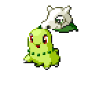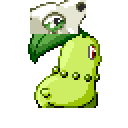on Chikorita</td></tr>
<tr><td></td><td><b>CHARIZARD SKULL</b>the Cubone skull in Charizard's colourslends Fire; sits on the head</td><td>Solar Power</td><td class="worn">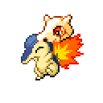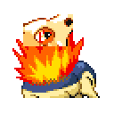on Cyndaquil</td></tr>
<tr><td></td><td><b>HEAD SHELL</b>cut from Onix's own spriteslends Rock; sits on the head</td><td>Rock Head</td><td class="worn">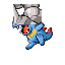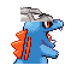on Totodile</td></tr>
<tr><td></td><td><b>ARBOK VENOM</b>cut from Arbok's own spriteslends Poison; sits over the face</td><td>Poison Touch</td><td class="worn">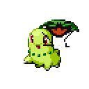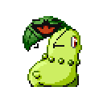on Chikorita</td></tr>
<tr><td></td><td><b>TOGEPI SHELL</b>cut from Togepi's own spriteslends Fairy; sits around the body</td><td>Serene Grace</td><td class="worn">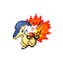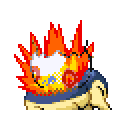on Cyndaquil</td></tr>
<tr><td></td><td><b>PUPITAR SHELL</b>cut from Pupitar's own spriteslends Rock; sits on the head</td><td>Shed Skin</td><td class="worn">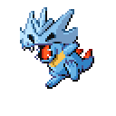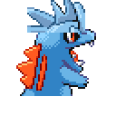on Totodile</td></tr>
<tr><td></td><td><b>LOTAD LILY</b>cut from Lotad's own spriteslends Water; sits on the head</td><td>Rain Dish</td><td class="worn">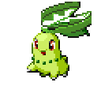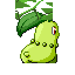on Chikorita</td></tr>
<tr><td></td><td><b>SWELLOW TAIL</b>cut from Swellow's own spriteslends Flying; sits on the back (behind the Pokémon when it faces you)</td><td>Guts</td><td class="worn">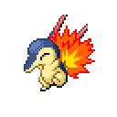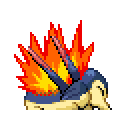on Cyndaquil</td></tr>
<tr><td></td><td><b>KIRLIA ANTENNA</b>cut from Kirlia's own spriteslends Psychic; sits on the head</td><td>Telepathy</td><td class="worn">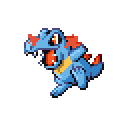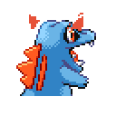on Totodile</td></tr>
<tr><td></td><td><b>BRELOOM CAP</b>cut from Breloom's own spriteslends Grass; sits on the head</td><td>Effect Spore</td><td class="worn">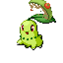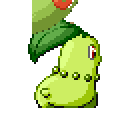on Chikorita</td></tr>
<tr><td></td><td><b>HARIYAMA PANTS</b>cut from Hariyama's own spriteslends Fighting; sits around the body</td><td>Thick Fat</td><td class="worn">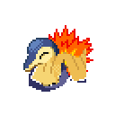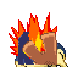on Cyndaquil</td></tr>
<tr><td></td><td><b>SABLEYE EYES</b>cut from Sableye's own spriteslends Dark; sits over the face</td><td>Keen Eye</td><td class="worn">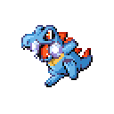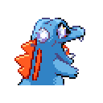on Totodile</td></tr>
<tr><td></td><td><b>ROSELIA ROSE</b>cut from Roselia's own spriteslends Grass; sits on the head</td><td>Natural Cure</td><td class="worn">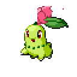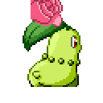on Chikorita</td></tr>
<tr><td></td><td><b>SHARPEDO SKIN</b>cut from Sharpedo's own spriteslends Water; sits on the head</td><td>Rough Skin</td><td class="worn">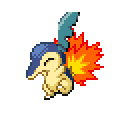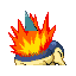on Cyndaquil</td></tr>
<tr><td></td><td><b>FLYGON EYES</b>cut from Flygon's own spriteslends Ground; sits over the face</td><td>Compound Eyes</td><td class="worn">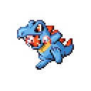on Totodile</td></tr>
<tr><td></td><td><b>DUSKULL MASK</b>cut from Duskull's own spriteslends Ghost; sits over the face</td><td>Infiltrator</td><td class="worn">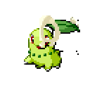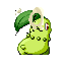on Chikorita</td></tr>
<tr><td></td><td><b>METAGROSS CROSS</b>cut from Metagross's own spriteslends Steel; sits over the face</td><td>Clear Body</td><td class="worn">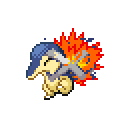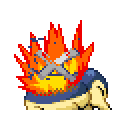on Cyndaquil</td></tr>
<tr><td></td><td><b>BASTIODON SHIELD</b>cut from Bastiodon's own spriteslends Rock; sits over the face</td><td>Sturdy</td><td class="worn">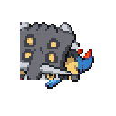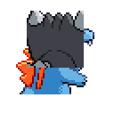on Totodile</td></tr>
<tr><td></td><td><b>SKUNTANK OIL</b>cut from Skuntank's own spriteslends Poison; sits on the head</td><td>Stench</td><td class="worn">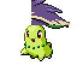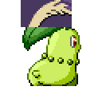on Chikorita</td></tr>
<tr><td></td><td><b>SCYTHER WINGS</b>cut from Scyther's own spriteslends Bug; sits on the back (behind the Pokémon when it faces you)</td><td>Technician</td><td class="worn">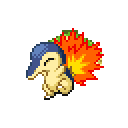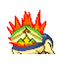on Cyndaquil</td></tr>
<tr><td></td><td><b>LAPRAS SHELL</b>cut from Lapras's own spriteslends Water; sits on the back (behind the Pokémon when it faces you)</td><td>Shell Armor</td><td class="worn">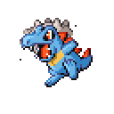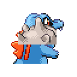on Totodile</td></tr>
<tr><td></td><td><b>MAREEP WOOL</b>cut from Mareep's own spriteslends Electric; sits around the body</td><td>Static</td><td class="worn">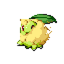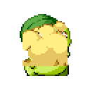on Chikorita</td></tr>
<tr><td></td><td><b>SNEASEL FEATHER</b>cut from Sneasel's own spriteslends Dark; sits on the head</td><td>Pickpocket</td><td class="worn">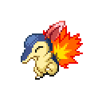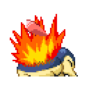on Cyndaquil</td></tr>
<tr><td></td><td><b>MAGCARGO SHELL</b>cut from Magcargo's own spriteslends Fire; sits on the back (behind the Pokémon when it faces you)</td><td>Flame Body</td><td class="worn">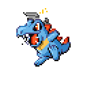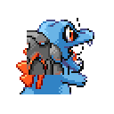on Totodile</td></tr>
<tr><td></td><td><b>KABUTOPS CLEAVERS</b>cut from Kabutops's own spriteslends Rock; sits on the back (behind the Pokémon when it faces you)</td><td>slash moves ×1.2</td><td class="worn">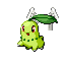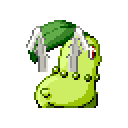on Chikorita</td></tr>
<tr><td></td><td><b>PINSIR HORNS</b>cut from Pinsir's own spriteslends Bug; sits on the head</td><td>stab moves ×1.2</td><td class="worn">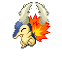on Cyndaquil</td></tr>
<tr><td></td><td><b>BEEDRILL STINGER</b>cut from Beedrill's own spriteslends Bug; sits around the body</td><td>stab moves ×1.2; a stab that hits poisons one time in ten</td><td class="worn">on Totodile</td></tr>
<tr><td></td><td><b>PIDGEOT FEATHERS</b>cut from Pidgeot's own spriteslends Flying; sits on the head</td><td>wind moves ×1.2</td><td class="worn">on Chikorita</td></tr>
<tr><td></td><td><b>PREDATOR TEETH</b>cut from Feraligatr's own spriteslends Water; sits over the face</td><td>bite moves ×1.2</td><td class="worn">on Cyndaquil</td></tr>
<tr><td></td><td><b>SANDSLASH CLAWS</b>cut from Sandslash's own spriteslends Ground; sits around the body</td><td>slash moves ×1.1 and a critical-hit stage</td><td class="worn">on Totodile</td></tr>
<tr><td></td><td><b>DRILL HORN</b>cut from Rhydon's own spriteslends Ground; sits over the face</td><td>stab moves ×1.2</td><td class="worn">on Chikorita</td></tr>
<tr><td></td><td><b>BAYLEEF LEAF BLADE</b>cut from Bayleef's own spriteslends Grass; sits on the head</td><td>slash moves ×1.2</td><td class="worn">on Cyndaquil</td></tr>
<tr><td></td><td><b>LOUDRED EARS</b>cut from Loudred's own spriteslends Normal; sits on the head</td><td>sound moves ×1.2</td><td class="worn">on Totodile</td></tr>
<tr><td></td><td><b>SEVIPER VENOM</b>cut from Seviper's own spriteslends Poison; sits over the face</td><td>bite moves ×1.1; a bite that hits poisons one time in ten</td><td class="worn">on Chikorita</td></tr>
<tr><td></td><td><b>ABSOL BLADE</b>cut from Absol's own spriteslends Dark; sits on the head</td><td>slash moves ×1.1 and a critical-hit stage</td><td class="worn">on Cyndaquil</td></tr>
<tr><td></td><td><b>EMPOLEON TRIDENT</b>cut from Empoleon's own spriteslends Water; sits on the head</td><td>stab moves ×1.2</td><td class="worn">on Totodile</td></tr>
<tr><td></td><td><b>MAMOSWINE TUSK</b>cut from Mamoswine's own spriteslends Ice; sits over the face</td><td>stab moves ×1.2 (poached: no wild drop; the black market's, later)</td><td class="worn">on Chikorita</td></tr>
<tr><td></td><td><b>OCTILLERY CANNON</b>cut from Octillery's own spriteslends Water; sits over the face</td><td>ballistic moves ×1.2</td><td class="worn">on Cyndaquil</td></tr>
<tr><td></td><td><b>HAXORUS BLADE</b>cut from Haxorus's own spriteslends Dragon; sits over the face</td><td>slash moves ×1.2</td><td class="worn">on Totodile</td></tr>
<tr><td></td><td><b>TINKATON HAMMER</b>cut from Tinkaton's own spriteslends Fairy; sits on the back (behind the Pokémon when it faces you)</td><td>blunt moves ×1.2</td><td class="worn">on Chikorita</td></tr>
<tr><td></td><td><b>BOXING GLOVES</b>cut from Hitmonchan's own spriteslends Fighting; sits around the body</td><td>punch moves ×1.1</td><td class="worn">on Cyndaquil</td></tr>
<tr><td></td><td><b>SCEPTILE TAIL</b>cut from Sceptile's own spriteslends Grass; sits on the back (behind the Pokémon when it faces you)</td><td>Speed ×1.2 for a Grass-type wearer</td><td class="worn">on Totodile</td></tr>
<tr><td></td><td><b>BULBASAUR BULB</b>cut from Bulbasaur's own spriteslends Grass; sits on the back (behind the Pokémon when it faces you)</td><td>Sp. Def ×1.2 for a Grass-type wearer</td><td class="worn">on Chikorita</td></tr>
<tr><td></td><td><b>HERACROSS SHELL</b>cut from Heracross's own spriteslends Bug; sits on the back (behind the Pokémon when it faces you)</td><td>Defense ×1.2 for a Bug-type wearer</td><td class="worn">on Cyndaquil</td></tr>
<tr><td></td><td><b>SHIFTRY BARK</b>cut from Shiftry's own spriteslends Grass; sits around the body</td><td>Defense ×1.2 for a Grass-type wearer</td><td class="worn">on Totodile</td></tr>
<tr><td></td><td><b>SPOINK PEARL</b>cut from Spoink's own spriteslends Psychic; sits on the head</td><td>Sp. Atk ×1.2 for a Psychic-type wearer</td><td class="worn">on Chikorita</td></tr>
<tr><td></td><td><b>SHINX STAR</b>cut from Shinx's own spriteslends Electric; sits on the head</td><td>Speed ×1.2 for an Electric-type wearer</td><td class="worn">on Cyndaquil</td></tr>
<tr><td></td><td><b>SHUCKLE SHELL</b>cut from Shuckle's own spriteslends Bug; sits around the body</td><td>Defense and Sp. Def ×1.1 for any wearer</td><td class="worn">on Totodile</td></tr>
<tr><td></td><td><b>BEAUTIFLY PROBOSCIS</b>cut from Beautifly's own spriteslends Bug; sits over the face</td><td>draining moves heal 30% more</td><td class="worn">on Chikorita</td></tr>
<tr><td></td><td><b>HYPNO PENDULUM</b>cut from Hypno's own spriteslends Psychic; sits around the body</td><td>sleep moves' accuracy ×1.2</td><td class="worn">on Cyndaquil</td></tr>
<tr><td></td><td><b>SUNFLORA PETALS</b>cut from Sunflora's own spriteslends Grass; sits on the back (behind the Pokémon when it faces you)</td><td>1/16 of its HP back each turn in harsh sunlight</td><td class="worn">on Totodile</td></tr>
<tr><td></td><td><b>SHEDINJA SHELL</b>cut from Shedinja's own spriteslends Bug; sits on the back (behind the Pokémon when it faces you)</td><td>once a battle, lives through a hit that isn't super effective with 1 HP</td><td class="worn">on Chikorita</td></tr>
</tbody>
</table>

The type a part lends is its donor's first type (its second when the first is Normal, so a bird's
part lends Flying): with **MUTAGEN → THIRD TYPE** on it is the wearer's third type while the part
is worn, in the summary and in battle. A Pokémon that already
has a third type of its own is asked which to show; its own type is never written over, and comes
back when the part comes off. A stat part asks for a wearer of that same type, so with THIRD TYPE on
every wearer qualifies unless it keeps a third type of its own (design note: [Species items](design/items.md)).
